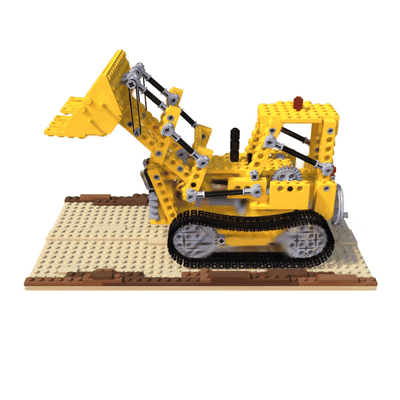
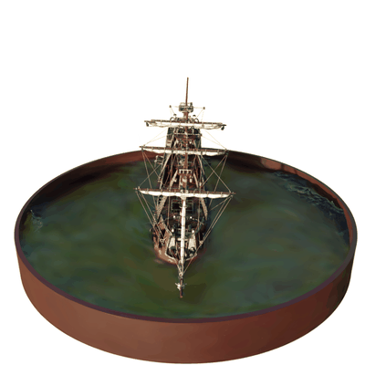
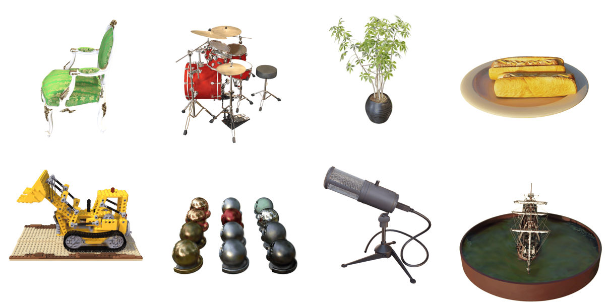
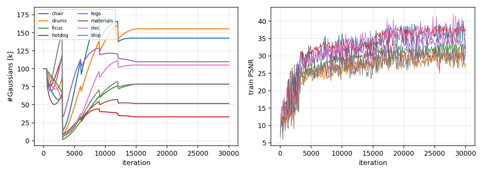

# 3D Gaussian Splatting: a from-scratch training system with a pure-PyTorch reference rasteriser

A complete 3DGS implementation (Kerbl et al., SIGGRAPH 2023) built around the `gsplat` CUDA
rasteriser for speed, with **every other part written from scratch**: the Gaussian
representation (quaternion-scale covariance, spherical-harmonic colour), EWA projection,
adaptive density control (clone / split / prune / opacity reset with optimiser-state
surgery), the L1 + D-SSIM objective, the learning-rate schedule, evaluation (PSNR / SSIM /
LPIPS / FPS), standard `.ply` export, and a **readable pure-PyTorch reference rasteriser**
(depth-sorted per-pixel alpha compositing) that reproduces the maths of the paper, is used by
the unit tests and lets the whole pipeline run on a CPU at small resolution.

## Extension (branch `aerial-geometry`): geometric acceptance of a splat against a laser reference, with sparse LiDAR depth supervision

A rendered splat can score well on PSNR while its *geometry* is metres off; DJI Terra ships GS reconstruction
but does not allow measuring on it for exactly this reason. This branch turns the training system into a
geometry-acceptance pipeline and tests the most direct fix, sparse LiDAR depth as a training constraint.

* **Depth rendering** in both backends: expected depth `D = Σ w_i z_i / Σ w_i` and accumulated opacity `A = Σ w_i`
  (`gs/render.py`, `return_depth=True`; gsplat `RGB+ED`).
* **Geometry evaluation** (`gs/geometry.py`, `run_geometry.py`): training-view depth → fused point cloud (2 cm voxels) →
  accuracy / completeness / F-score at 2, 5, 10, 20 cm, point-to-plane distance against the laser normals,
  a 1 m grid of mean and p90 error (heat map) and a pass/fail acceptance table at 5 / 10 / 20 cm tolerance;
  Umeyama Sim(3) + ICP alignment for scenes whose pose frame differs from the laser frame.
* **Sparse LiDAR supervision** (`gs/lidar.py`): the reference cloud is subsampled to 10 cm, z-buffer-projected into
  every training view (2 px splat, 3.7 % of pixels covered), and a robust L1 between rendered and LiDAR depth,
  normalised by the scene's median depth, is added with weight `--lambda_depth`.
* **Spatial block hold-out**: 50 % of all blocks are hidden from supervision; metrics are reported for all /
  supervised / held-out blocks so that an improvement can be told apart from copying the LiDAR back in. The split is
  drawn once on the supervision reference and both clouds are assigned to it by block membership.
* Data tools for ETH3D high-res multi-view (`tools/prepare_eth3d.py`: merges the Faro scans via `scan_alignment.mlp`)
  and for UAVScenes aerial runs (`tools/prepare_uavscenes.py`: DJI M300 RTK + Livox Avia; accumulates the Avia scans,
  keeps the points at least two cameras see, measures the LiDAR map's repeatability from odd / even scans and crops the
  DJI Terra map as a second reference), a CPU synthetic scene, covered-pixel PSNR re-scoring, multi-seed aggregation,
  re-scoring of finished runs (`tools/rescore_heldout.py`); 18 unit tests in total.

### Results (ETH3D, images at 1/4 resolution, 30k iterations)

courtyard (33 train / 5 test views, 3.5 M laser points); mean ± s.d. over 2 seeds:

| | photos only | + LiDAR depth, λ = 0.5 |
|---|---|---|
| test-view PSNR | 15.72 ± 1.10 | 19.89 ± 0.29 |
| mean distance to laser surface (acc_mean, clipped 1 m) | 0.711 ± 0.083 m | 0.234 ± 0.009 m |
| F-score @ 10 cm | 0.075 ± 0.028 | 0.614 ± 0.020 |
| test-view depth error | 1.83 m | 0.22 m |
| acc_mean, supervised blocks (seed 0 / seed 1) | 0.395 / 0.357 m | 0.126 / 0.117 m |
| acc_mean, blocks **hidden** from supervision (seed 0 / seed 1) | 0.408 / 0.360 m | 0.178 / 0.164 m |

terrace (20 / 3 views, seed 0): acc_mean 0.805 → 0.289 m, comp_mean 0.440 → 0.051 m, F@10cm 0.045 → 0.580,
test-view depth error 3.37 → 0.36 m, PSNR 18.0 → 20.5; supervised / hidden blocks 0.531 / 0.481 m → 0.118 / 0.191 m.

λ sweep (courtyard, seed 0): geometry improves monotonically with λ (acc_mean 0.77 / 0.37 / 0.24 / 0.20 m at
λ = 0 / 0.1 / 0.5 / 2), image quality peaks at λ = 0.1 (21.0 dB) and drops ~1.4 dB by λ = 2.

### Results (UAVScenes AMvalley01, aerial, seed 0)

200 m × 200 m window, 120 images at 1/4 resolution (612 × 512, ~0.36 m ground sampling distance, ~130 m above ground),
937 Avia scans → 3.18 M LiDAR points visible in at least two cameras; LiDAR repeatability (odd vs even scans) median
0.14 m, p90 0.27 m, so tolerances are 0.3 / 0.5 / 1.0 m and the grid is 5 m. LiDAR depth covers 39 % of pixels here.

| | photos only | + LiDAR depth, λ = 0.5 |
|---|---|---|
| test-view PSNR | 24.29 | 24.36 |
| vs LiDAR: acc_mean / comp_mean (clipped 5 m) | 2.28 / 1.56 m | 0.82 / 0.56 m |
| vs LiDAR: F-score @ 0.5 m | 0.363 | 0.622 |
| vs LiDAR: test-view depth error | 4.66 m | 1.31 m |
| vs LiDAR: 5 m cells passing at 0.5 m / 1.0 m (of 1936) | 17 / 338 | 285 / 1266 |
| vs LiDAR: acc_mean, supervised / hidden blocks (10 m) | 1.493 / 1.496 m | 0.514 / 0.617 m |
| vs DJI Terra map (never used in training): acc_mean / comp_mean | 3.00 / 1.31 m | 1.61 / 0.79 m |
| vs DJI Terra map: F-score @ 0.3 m / 1.0 m | 0.171 / 0.371 | 0.160 / 0.536 |

What the numbers do and do not say. With rendering quality unchanged on the aerial scene, geometry moves from metres
to decimetres, and the gain is confirmed by a reference that took no part in training, but only at coarse tolerance:
F-score at 0.3 m against the Terra map does not improve, the LiDAR surface sits a median 0.23 m above the Terra surface,
and the LiDAR map itself repeats to 0.14 m. The hold-out shows that accuracy gains transfer to blocks without any LiDAR
but are smaller there: hidden blocks trail supervised blocks by about 5 cm on courtyard, 7 cm on terrace and 10 cm on
the aerial scene, while photo-only runs show no such gap on courtyard and the aerial scene (terrace's photo-only run
has hidden blocks 5 cm better). Completeness transfers only partially (courtyard 0.081 vs 0.022 m). Block metrics count
only reconstructed points inside blocks the reference occupies (32–45 % of the points for the photo-only courtyard
runs), so they are not comparable with the all-points rows. Post-training floater pruning against the sparse LiDAR
depth changes the metrics by < 0.01 m because only ~10 % of Gaussians fall on a LiDAR-covered pixel (negative result,
kept). The ETH3D photo-only baseline is weak because these scenes are sparse-view (train PSNR 31–33 vs test 15–21;
masking sky changes < 0.7 dB), so the PSNR gain there should not be read as general. At 5 cm tolerance almost no 1 m
cell passes on either ETH3D scene; the acceptance table only discriminates at 10–20 cm. Between the two courtyard seeds
the baseline moved by 0.12 m and the constrained run by 0.012 m.
An earlier version of this section reported hidden-block accuracy equal to supervised-block accuracy; that came from a
bug that drew the block split separately for the reconstruction and the reference, fixed in `gs/geometry.py` with a
regression test; the runs reported here were re-scored from their saved point clouds.
Not yet done: a second aerial seed and an aerial λ sweep, a third courtyard seed, terrace repeats, the 76-view `facade`
scene, and training-time variants (`--depth_from`, `--splat 3`, `--lidar_voxel 0.05`).

```bash
python tools/prepare_eth3d.py --raw raw/courtyard --out data/eth3d/courtyard --downscale 4 --gt_voxel 0.02
python run_geometry.py --data data/eth3d/courtyard --out runs/courtyard_base --lambda_depth 0      # baseline
python run_geometry.py --data data/eth3d/courtyard --out runs/courtyard_d0p5 --lambda_depth 0.5    # LiDAR-constrained
python tools/aggregate_runs.py --root runs                                                          # mean ± s.d. table

# aerial (UAVScenes run extracted to raw/AMvalley01)
python tools/prepare_uavscenes.py --root raw/AMvalley01 --out data/uav/amvalley01_w200 --calib AMvalley --window 200 --max_images 120
UAV="--block 10 --cell 5 --lidar_voxel 0.5 --fuse_voxel 0.1 --taus 0.2,0.3,0.5,1.0 --max_dist 5 --tolerance 0.5 --tolerances 0.3,0.5,1.0"
python run_geometry.py --data data/uav/amvalley01_w200 --out runs/uav_d0p5 --lambda_depth 0.5 $UAV
python run_geometry.py --data data/uav/amvalley01_w200 --out runs/uav_d0p5_vsTerra $UAV --eval_only --ply runs/uav_d0p5/point_cloud.ply \
    --gt data/uav/amvalley01_w200/terra_ref.ply --split_ref data/uav/amvalley01_w200/gt_scan.ply                # second reference
```

Outputs per run: `metrics.json` (image, geometry all / supervised / held-out, test-view depth, acceptance tables,
supervision and fusion stats, full config), `error_heatmap.png`, `error_grid.npz`, `fused_points.ply`,
`point_cloud.ply`, `test_renders/`.

<p align="center">
&nbsp;

</p>

## Results (Tesla T4, Colab)

<p align="center"></p>
<p align="center"><i>Turntable renders of the trained models (chair, drums, ficus, hotdog / lego, materials, mic, ship); full GIFs in <code>results/scenes/*/turntable.gif</code></i></p>

### NeRF-synthetic benchmark (30k iterations, 800x800, 200 test views per scene)

| scene | PSNR (ours) | PSNR (paper) | SSIM | LPIPS | #Gaussians | train [min] | render FPS |
|---|---|---|---|---|---|---|---|
| chair | 34.39 | 35.83 | 0.981 | 0.026 | 143k | 14 | 235 |
| drums | 25.89 | 26.15 | 0.947 | 0.061 | 155k | 14 | 229 |
| ficus | 29.79 | 34.87 | 0.968 | 0.040 | 79k | 12 | 312 |
| hotdog | 34.97 | 37.72 | 0.975 | 0.055 | 33k | 11 | 337 |
| lego | 31.28 | 35.78 | 0.960 | 0.052 | 110k | 14 | 263 |
| materials | 27.47 | 30.00 | 0.936 | 0.085 | 52k | 11 | 366 |
| mic | 33.93 | 35.36 | 0.988 | 0.015 | 105k | 13 | 256 |
| ship | 27.76 | 30.80 | 0.865 | 0.214 | 79k | 13 | 258 |
| **mean** | **30.68** | **33.31** | | | | | |

### Ablation (lego)

| variant | PSNR | SSIM | LPIPS | #Gaussians | train [min] | FPS |
|---|---|---|---|---|---|---|
| full (30k, densify to 15k, SH deg 3, grad thr 2e-4) | 31.45 | 0.960 | 0.051 | 110k | 13 | 271 |
| no adaptive density control (300k fixed random Gaussians) | 13.52 | 0.725 | 0.425 | 300k | 29 | 68 |
| SH degree 0 (view-independent colour) | 31.03 | 0.958 | 0.053 | 158k | 13 | 245 |
| densification gradient threshold x2 (4e-4) | 28.38 | 0.929 | 0.097 | 20k | 11 | 451 |
| densification gradient threshold /2 (1e-4) | 33.54 | 0.974 | 0.030 | 444k | 22 | 129 |
| densification stopped at 5k iterations | 31.22 | 0.958 | 0.056 | 84k | 13 | 293 |
| 7k iterations only | 28.63 | 0.932 | 0.094 | 36k | 3 | 369 |

### Same scene, same GPU: HashNeRF (previous project) vs 3D Gaussian Splatting (lego)

| method | PSNR | SSIM | train [min] | render FPS | note |
|---|---|---|---|---|---|
| HashNeRF (Instant-NGP style, pure PyTorch, previous project) | 24.36 | 0.883 | 29 | 0.4 | 400x400, 15000 iters, 25 test views |
| 3D Gaussian Splatting (this project) | 31.28 | 0.960 | 14 | 263.0 | 800x800, 30000 iters, 200 test views, 109k Gaussians |

Reading the numbers: with the paper's default densification threshold (2e-4) this implementation
ends up with far fewer Gaussians than the reference (lego: 110k vs. several hundred thousand) and
lands 2.6 dB below the paper on average. The ablation shows that this gap is a densification
setting, not a rendering or optimisation defect: halving the threshold takes lego to 33.5 dB with
444k Gaussians, close to the paper's 35.8, while removing density control altogether drops it to
13.5 dB. The HashNeRF comparison uses the same GPU and scene; the NeRF is trained at 400x400 for
15k iterations (its own budget), 3DGS at 800x800 for 30k, so the PSNR gap is indicative rather than
exact, but the 650x rendering-speed gap is the point of the comparison.

<p align="center"></p>
<p align="center"><i>Gaussian count (left) and training PSNR (right) over the 30k iterations. The sawtooth in the
count is the periodic opacity reset followed by pruning; densification stops at 15k.</i></p>

## What is implemented

| component | file | notes |
|---|---|---|
| Gaussian representation | `gs/model.py` | means, log-scales, quaternions, opacity logits, SH coefficients (degree 0-3); covariance `R S S^T R^T` is PSD by construction |
| Adaptive density control | `gs/model.py` | screen-space gradient statistics; clone small / split large Gaussians (children sampled from the parent, scale / 1.6); prune transparent, oversized and split parents; periodic opacity reset; Adam moments are sliced / extended so the optimiser stays consistent |
| EWA projection + SH | `gs/render.py` | 3-D -> 2-D covariance through the projective Jacobian, 0.3 px low-pass, real SH evaluation with the reference ordering |
| Reference rasteriser | `gs/render.py` | pure PyTorch, differentiable, depth-sorted front-to-back compositing with early alpha cutoff; no tiles, meant for tests and small images |
| CUDA rasteriser | `gs/render.py` | `gsplat.rasterization` with `absgrad` for densification statistics; identical interface to the reference |
| Loss / metrics | `gs/losses.py` | L1 + 0.2 D-SSIM with an 11x11 Gaussian window; PSNR, SSIM; LPIPS (VGG) at evaluation |
| Training schedule | `gs/trainer.py` | 30k iterations, SH degree +1 every 1k, densify every 100 from 500 to 15k, opacity reset every 3k, exponential position LR scaled by scene extent |
| Data | `gs/data.py` | NeRF-synthetic json + RGBA; COLMAP captures via `tools/colmap_to_transforms.py` (poses + sparse points for initialisation) |
| Experiments | `run_benchmark.py`, `nerf_compare.py`, `make_report.py`, `run_all_colab.ipynb` | resumable benchmark + ablations, NeRF comparison, tables and figures |
| Tests | `tests/test_gs.py` | rotation/PSD, single-Gaussian rendering, depth ordering, gradient flow, SH, densification + optimiser consistency, SSIM |

## Run it

```bash
pip install torch gsplat lpips imageio scikit-image
python -m pytest -q tests                                                   # CPU, seconds
python train_scene.py --data data/nerf_synthetic/lego --out runs/lego       # GPU, ~10 min on a T4
python train_scene.py --data data/nerf_synthetic/lego --out runs/smoke --device cpu --downscale 10 --iters 120 --n_init 500   # CPU smoke run
python run_benchmark.py --data data/nerf_synthetic --out results --scenes all --ablations
python nerf_compare.py --data data/nerf_synthetic/lego --results results
python make_report.py results
```

`run_all_colab.ipynb` runs the whole set on a free Colab GPU with results saved to Google Drive.

## What I learned

1. **Density control is the algorithm.** Without it (300k fixed random Gaussians) the same
   optimiser reaches 13.5 dB; with it, 31.5 dB. The gradient threshold is the single most
   important knob: 4e-4 gives 20k Gaussians / 28.4 dB / 451 FPS, 1e-4 gives 444k / 33.5 dB /
   129 FPS. Quality, memory and frame rate are all set by this one number.
2. **Optimiser surgery matters.** Cloning / splitting / pruning changes the parameter
   tensors; Adam's first and second moments have to be sliced and extended in the same way
   or the new Gaussians inherit stale statistics and training destabilises.
3. **A reference implementation pays for itself.** When the first GPU runs produced washed-out
   renders, rendering the same Gaussians through the pure-PyTorch rasteriser and through gsplat
   (mean pixel difference 7e-5, identical gradients) ruled out the whole rendering path in ten
   minutes and pointed at the training schedule: I had rescaled the 30k learning-rate decay to
   the length of a short debugging run, which froze the positions after a few hundred steps.
   The paper's schedule is now used unchanged whatever the run length.
4. **Short runs must be prefixes of the real schedule, not compressed versions of it.** Scaling
   the opacity-reset interval down to 100 iterations made the first reset coincide with the
   large-Gaussian pruning pass and deleted 99.99% of the scene.

## References

Kerbl, Kopanas, Leimkuehler, Drettakis, *3D Gaussian Splatting for Real-Time Radiance Field Rendering* (SIGGRAPH 2023) ·
Ye et al., *gsplat: An Open-Source Library for Gaussian Splatting* (2024) · Zwicker et al., *EWA Splatting* (2002)
